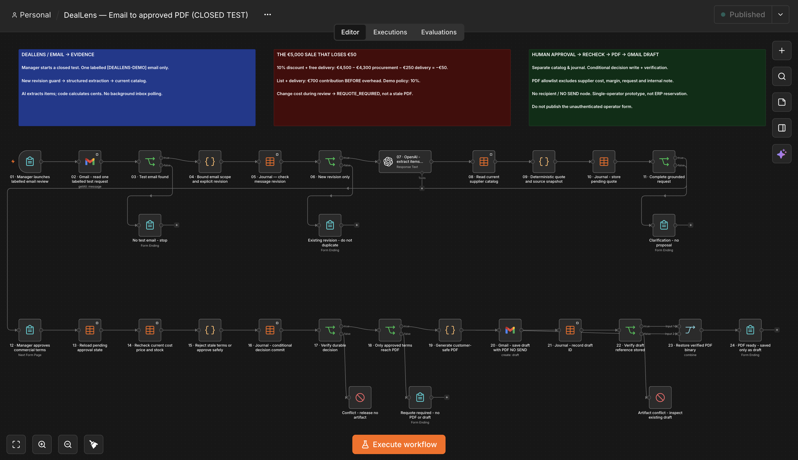

# DealLens | Контроль маржі B2B-пропозицій до відправлення клієнту

## Замовлення на €5 000 теж може бути збитковим

У сценарії B2B-постачальника промислового обладнання в Німеччині покупець замовляє два компресори, просить 10% знижки та безкоштовну доставку. DealLens показує наслідки цих умов до підготовки пропозиції, а після погодження менеджером повторно перевіряє каталог.

**Статус проєкту:** власний робочий прототип на синтетичних даних із живими закритими перевірками n8n і Gmail. Німеччина є контекстом сценарію, а не країною реального замовника. Фактична економія клієнта чи комерційне впровадження не заявляються.

## 1. Бізнес-ризик

Команда продажів може погодити знижку, пообіцяти доставку й підготувати гарну пропозицію, не помітивши, що поступки вже з'їли весь маржинальний дохід. Навіть правильний початковий розрахунок може застаріти під час погодження.

Комерційні умови потрібно перевіряти до створення документа для покупця, а не лише після продажу.

## 2. Прозора економіка

| Сума без ПДВ | Запитані умови | Альтернатива для погодження |
| --- | ---: | ---: |
| Каталожна вартість обладнання | €5 000 | €5 000 |
| Виручка за обладнання після знижки | €4 500 | €5 000 |
| Оплата доставки покупцем | €0 | €250 |
| Закупівля | €4 300 | €4 300 |
| Витрати на доставку | €250 | €250 |
| **Маржинальний дохід до накладних витрат і податків** | **−€50** | **€700** |

Альтернатива прибирає знижку й передбачає окрему оплату доставки. Покупець ще має погодитися на ці умови. Це модельний розрахунок, а не отримані гроші, чистий прибуток чи виміряна економія клієнта. Мінімальна маржа є демонстраційною політикою, а не стандартом німецького ринку.

## 3. Що я реалізував

1. Оператор вручну запускає перевірку одного позначеного листа Gmail.
2. AI витягує товари й кількість із підтвердженням у вихідному тексті. Менеджер перевіряє запит і знижку.
3. Код звіряє актуальний каталог, розраховує суми в центах і зберігає знімок пропозиції.
4. Людина обирає допустиму альтернативу або відхиляє запит.
5. Після погодження workflow перечитує збережений стан і каталог. Змінені чи прострочені умови повертаються на перегляд, а не потрапляють у застарілий PDF.
6. Підтверджений запис рішення дозволяє сформувати PDF для покупця та чернетку Gmail без адресата. Отриманий ID чернетки зберігається й перевіряється.

**AI не встановлює ціни, не погоджує поступки та не відправляє листи.** Прототип також не приймає замовлення й не резервує склад.

## 4. Ключова перевірка

Я змінив закупівельну ціну, поки workflow очікував погодження менеджера. Після продовження система виявила зміну й зупинилася зі статусом `REQUOTE_REQUIRED`. Для застарілого розрахунку не виконалися ні створення PDF, ні створення чернетки Gmail.

Після погодження нової версії обидва матеріали були створені. Окреме читання чернетки Gmail підтвердило відсутність To/CC/BCC, наявність DRAFT без SENT і побайтовий збіг вкладення на 3 316 байт із PDF погодженого знімка.

Послідовний повтор тієї самої версії зупинився до нового виклику AI та створення PDF/чернетки. Це не гарантія коректності паралельних запусків чи exactly-once.

У публічному комплекті **18 локальних тестів**, які проходять: 16 початкових перевірок і захист публічного експорту та компоновки. Їх можна повторити без підключень. Вони не запускають заново історичний живий тест.

## 5. Користь для клієнта

- **Видима економіка угоди:** зрозуміло, що залишається після знижки та логістики ще до погодження.
- **Актуальні умови під час створення документа:** менший ризик підготувати пропозицію за застарілою собівартістю.
- **Менше перенесення даних і складання документів:** погоджені поля стають PDF та вкладенням чернетки. Економію часу ще потрібно виміряти в процесі клієнта.
- **Коректне розділення інформації:** PDF для покупця не містить закупівельної ціни, маржі, вихідного листа чи внутрішніх приміток.
- **Простежуваність:** явна версія запиту, збережений знімок, статус рішення та посилання на чернетку Gmail.

Перед оцінкою впровадження я б перевірив кількість запитів, джерело каталогу, правила погодження, час підготовки пропозиції та вимоги до відновлення після помилок. Непідтверджені відсотки ROI чи скорочення зарплат тут не використовуються.

## 6. Матеріали реалізації

- [GitHub-репозиторій](https://github.com/vladyslav-moskalkov/deallens)
- [Вимкнений очищений JSON workflow](../workflows/deallens-email-to-approved-pdf.json)
- [Окремо згенерований PDF-приклад для покупця](../examples/approved-proposal-sample.pdf)
- [Налаштування](setup.md) · [Опис усіх нод](nodes.md) · [Межі перевірок](validation.md)

PDF-приклад згенерований із синтетичних погоджених даних і не є вкладенням історичного живого запуску. Оригінальний скриншот workflow збережений без перемальовування назв нод або результатів.

## 7. Що потрібно для впровадження

Авторизовані ролі погодження, підключення до достовірного каталогу, транзакційна унікальність, перевірки паралельних запусків, надійне відновлення чернетки/журналу, моніторинг і правила зберігання даних. Поточний PDF підтримує лише ASCII-назви товарів; Unicode-шрифти, локалізація та узгоджені податкові поля є окремою роботою перед запуском.

Публічний експорт вимкнений і не містить реальних credentials, ID таблиць, webhook ID, знімків пошти чи підписаних посилань погодження. Його форму оператора не можна публічно активувати як авторизований production-сервіс погодження.

## Обговорімо ваш процес

Перевірки знижок, зміни цін чи ручна підготовка пропозицій гальмують вашу команду? Розглянемо поточний процес і визначимо, які перевірки та інтеграції дадуть найбільшу практичну користь.

[Email](mailto:vladyslavmoskalkov@gmail.com) · [Telegram](https://t.me/vladislavbulldozer) · [LinkedIn](https://www.linkedin.com/in/vladyslav-moskalkov/)
